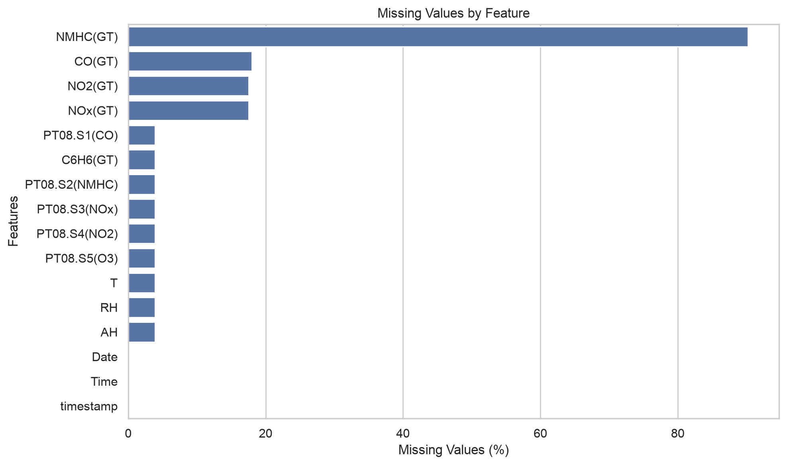
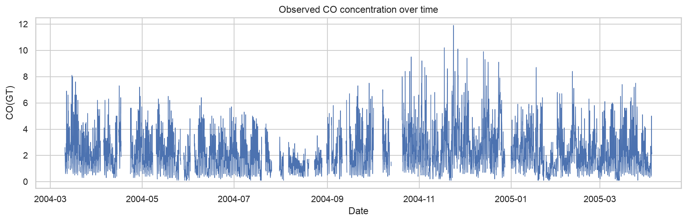
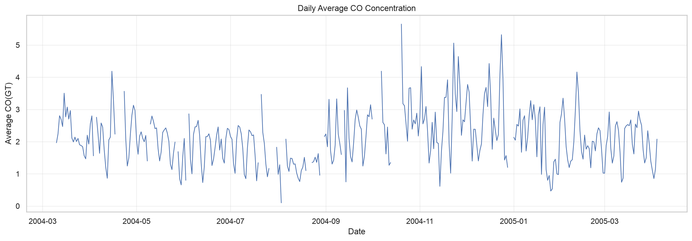
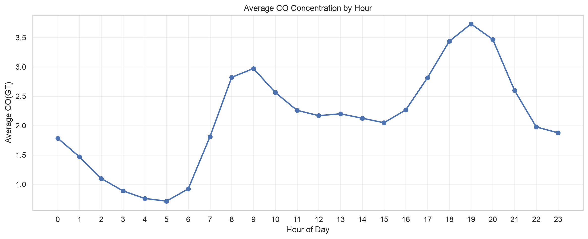
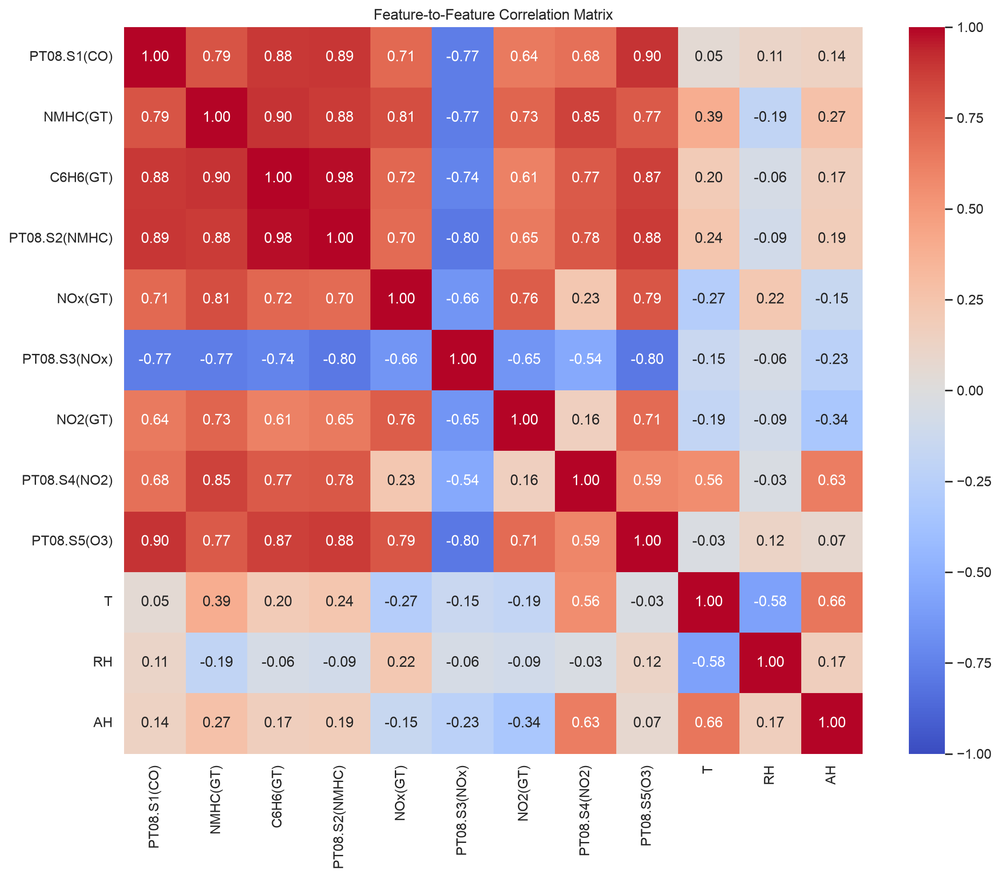
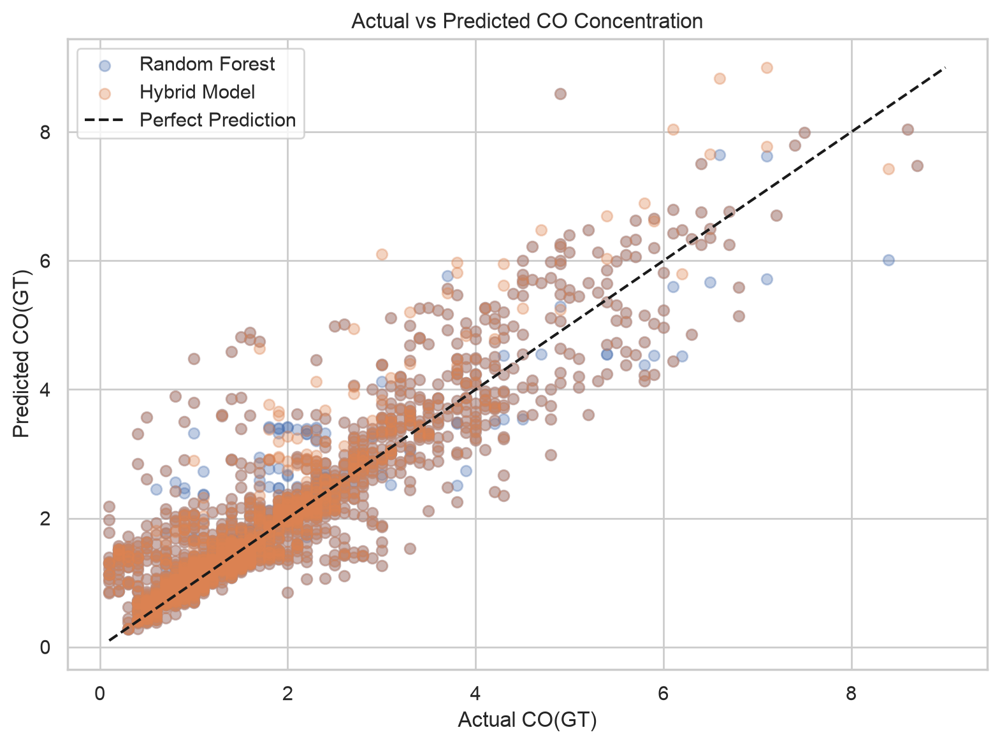
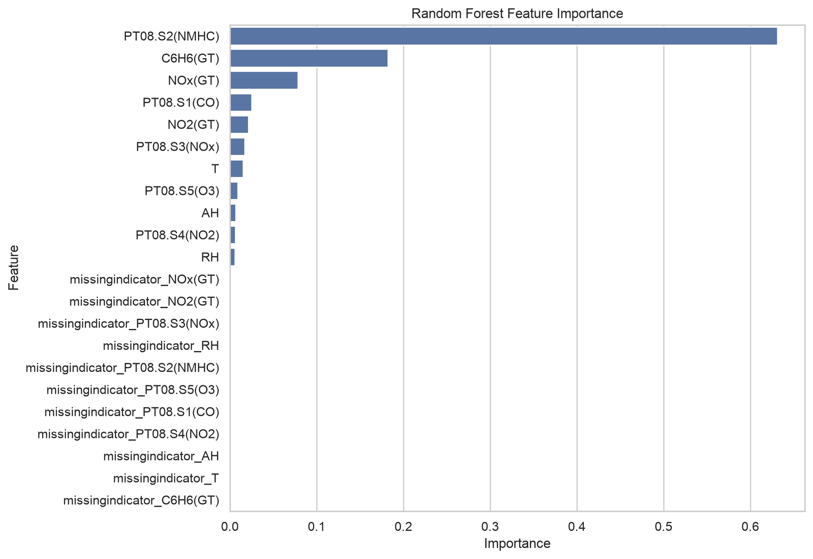

# Air Quality Prediction Using Machine Learning

A machine learning project focused on estimating **Carbon Monoxide (CO) concentration** using environmental sensor measurements, pollutant concentrations, and meteorological data.

**Version 2.0 — Improved Machine Learning Workflow**

## Project Overview

This project investigates how machine learning regression models can estimate CO concentration from environmental measurements.

Version 2.0 improves the original implementation through exploratory data analysis, time-aware evaluation, missing-data handling, and experimentation with a hybrid regression approach.

The objective remains **same-hour CO concentration estimation**, not future pollution forecasting.

## Dataset

**Source:** [UCI Machine Learning Repository — Air Quality](https://archive.ics.uci.edu/dataset/360/air+quality)

The dataset contains 9,357 hourly observations collected between March 2004 and April 2005.

It includes:

- Gas sensor responses
- CO, benzene, NOx, NO2, and NMHC measurements
- Temperature
- Relative humidity
- Absolute humidity
- Date and time information

The dataset is loaded directly from the UCI repository. No local CSV file is required.

Missing measurements are encoded as `-200` in the original dataset.

## Exploratory Data Analysis

EDA was performed to investigate data quality, missing measurements, temporal patterns, and relationships between variables.

### Missing Values

The analysis identified substantial missingness in several features.

Key findings:

- `NMHC(GT)` contains approximately 90% missing values and was excluded from modeling.
- Nine environmental measurements exhibit simultaneous missingness.
- Missing observations vary across time periods.
- The target variable, `CO(GT)`, also contains missing measurements.

### Temporal Analysis

CO concentrations were analyzed across hourly and daily intervals.

A bimodal daily pattern was observed, with concentration peaks around 9 AM and 7 PM.

### Feature Correlations

Correlation analysis identified strong relationships between several sensor measurements.

In particular, `C6H6(GT)` and `PT08.S2(NMHC)` showed a strong positive correlation, indicating potential multicollinearity.

## Data Preprocessing

The preprocessing workflow includes:

- Removing completely empty rows and columns
- Parsing and sorting timestamps
- Excluding the highly incomplete `NMHC(GT)` feature
- Removing observations with missing target values
- Median imputation with missing-value indicators
- Standard scaling for models requiring feature normalization

Preprocessing is integrated into scikit-learn pipelines to prevent data leakage during training and cross-validation.

## Train, Validation, and Test Split

A chronological split was used to respect the temporal structure of the dataset.

| Dataset | Proportion |
|---|---:|
| Training | 70% |
| Validation | 10% |
| Testing | 20% |

The split was performed before removing observations with missing targets.

Five-fold `TimeSeriesSplit` cross-validation was applied within the training set.

## Machine Learning Models

### Linear Regression

A linear regression pipeline using median imputation, missingness indicators, and standard scaling.

### Random Forest Regressor

An ensemble regression model using median imputation and missingness indicators.

### Hybrid Model

A hybrid approach was investigated to address simultaneous missing sensor measurements.

It combines:

- **Random Forest:** Main regression model
- **Ridge Regression:** Fallback model using NOx and NO2 when the nine-feature sensor group is unavailable

The fallback approach was evaluated to determine whether specialized handling of incomplete observations could improve performance.

## Model Evaluation

The models were evaluated using:

- **MAE:** Mean Absolute Error
- **RMSE:** Root Mean Squared Error
- **R²:** Coefficient of Determination

### Cross-Validation Results

| Model | MAE | RMSE | R² |
|---|---:|---:|---:|
| Linear Regression | 0.327 | 0.458 | 0.878 |
| Random Forest | 0.286 | 0.405 | 0.906 |
| Hybrid Model | 0.285 | 0.405 | 0.907 |

*Mean scores across five chronological cross-validation folds.*

### Validation Results

| Model | MAE | RMSE | R² |
|---|---:|---:|---:|
| Random Forest | 0.567 | 0.877 | 0.696 |
| Hybrid Model | **0.550** | **0.769** | **0.766** |

The Hybrid Model improved validation performance, particularly in cases with simultaneously missing sensor measurements.

### Final Test Results

| Model | MAE | RMSE | R² |
|---|---:|---:|---:|
| **Random Forest** | **0.413** | **0.644** | **0.780** |
| Hybrid Model | 0.421 | 0.659 | 0.770 |

Although the Hybrid Model performed better on the validation set, Random Forest achieved slightly better results on the final chronological test set.

The Hybrid Model was selected for final evaluation based on validation results. Both models' test results are reported transparently.

## Prediction Visualization

The following figure compares actual and predicted CO concentrations for both models on the final test set.

## Feature Importance

Random Forest feature importance is used to examine how the fitted model distributes predictive importance across its input features, including missingness indicators.

These importance scores are model-dependent and do not establish causal relationships.

## Key Findings

- Chronological evaluation provides a more realistic assessment of performance on later time periods than the original random split for this use case.
- Random Forest outperformed Linear Regression during cross-validation.
- Simultaneous missing measurements were associated with substantially weaker validation performance.
- A Ridge-based fallback improved validation performance but did not consistently outperform Random Forest across evaluation periods.
- Increasing model complexity did not guarantee better generalization.

## Limitations

- The dataset contains historical measurements from a single monitoring location.
- Some periods have substantial missing sensor measurements.
- Model performance varies across chronological evaluation periods.
- Missingness indicators and median imputation cannot fully recover unavailable environmental information.
- The project estimates CO concentration from measurements taken during the same period; it does not forecast future concentrations.
- The fallback strategy requires additional evaluation before real-world deployment.

## Technologies Used

- Python
- Pandas
- NumPy
- Scikit-learn
- Matplotlib
- Seaborn
- Jupyter Notebook

## Getting Started

Clone the repository:

`git clone https://github.com/altaleb-sarah/Air-Quality-ML.git`

Navigate to the project directory:

`cd Air-Quality-ML`

Install dependencies:

`python -m pip install -r requirements.txt`

Open `Air_Quality_ML.ipynb` in Jupyter Notebook or VS Code and run the cells in order.

An internet connection is required to download the dataset from UCI.

## Future Improvements

- Hyperparameter optimization
- Evaluation across additional chronological periods
- Alternative missing-data strategies
- Further analysis of feature importance and prediction errors

## Version History

**v1.0.0 — Initial Implementation**

Initial machine learning implementation using Linear Regression, Random Forest, basic preprocessing, and random train/test splitting.

**v2.0.0 — Improved ML Workflow**

Expanded EDA, chronological data splitting, time-series cross-validation, preprocessing pipelines, missing-data analysis, and hybrid modeling experiments.