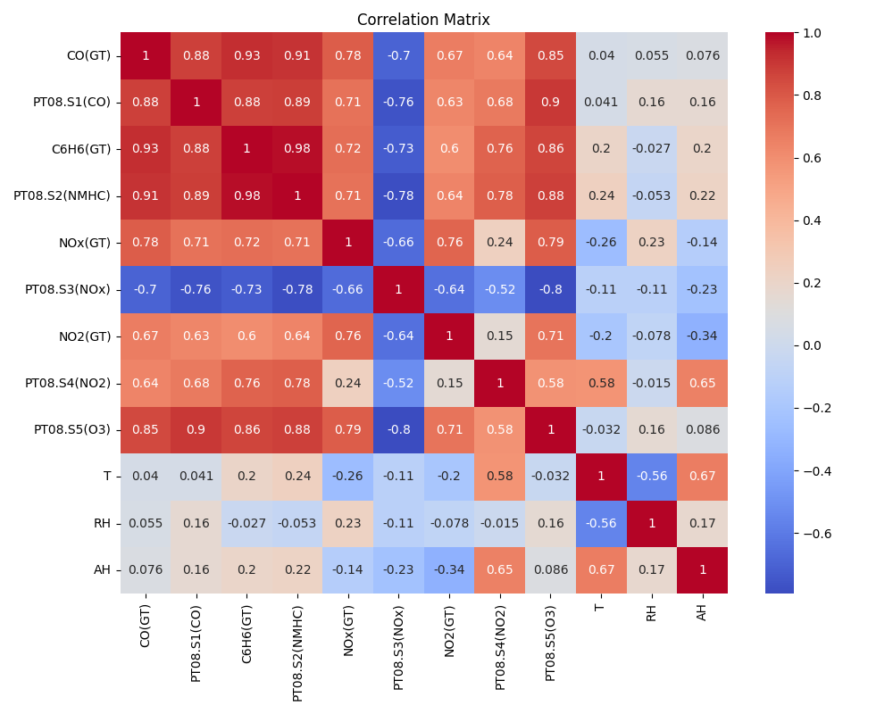
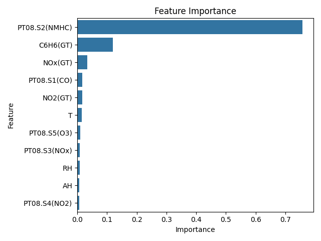

# Air Quality Prediction using Machine Learning

## Project Overview

This project applies Machine Learning techniques to predict Carbon Monoxide (CO) concentration using environmental sensor data from an air quality monitoring dataset.

The goal is to investigate how sensor measurements and environmental conditions can be used to estimate air pollution levels.

---

## Dataset

The dataset contains hourly averaged responses from an array of chemical sensors deployed in a polluted urban area.

It includes measurements of:

- Carbon Monoxide (CO)
- Benzene (C6H6)
- Nitrogen Oxides (NOx)
- Nitrogen Dioxide (NO2)
- Sensor responses
- Temperature
- Relative Humidity
- Absolute Humidity

Missing values in the dataset were originally encoded as **-200**.

## Dataset

Air Quality Dataset (Kaggle)

https://www.kaggle.com/datasets/fedesoriano/air-quality-data-set

---

## Data Preprocessing

The following preprocessing steps were applied:

- Removed unnecessary columns
- Replaced decimal commas with decimal points
- Converted numerical columns to numeric format
- Removed missing values
- Split features and target variable
- Standardized feature values using **StandardScaler**

---

## Exploratory Data Analysis

A correlation analysis was performed to understand relationships between variables.

### Correlation Matrix

The analysis showed strong correlations between several sensor readings and CO concentration.

---

## Machine Learning Models

Two regression models were implemented:

1. **Linear Regression**
2. **Random Forest Regressor**

The dataset was split into:

- **80% training data**
- **20% testing data**

---

## Model Evaluation

The models were evaluated using:

- Mean Squared Error (MSE)
- R² Score

| Model | MSE | R² |
|------|------|------|
Linear Regression | 0.239 | 0.88 |
Random Forest | 0.219 | 0.89 |

Random Forest slightly outperformed Linear Regression.

---

## Prediction Visualization

Actual vs predicted CO values:

The predictions closely follow the actual values, indicating good model performance.

---

## Feature Importance

Feature importance analysis using Random Forest shows which variables contribute most to CO prediction.

The **PT08.S2 (NMHC) sensor** was found to be the most influential feature.

---

## Conclusion

This project demonstrates that environmental sensor data can be effectively used to predict air pollution levels using Machine Learning.

Random Forest provided slightly better performance compared to Linear Regression.

---

## Technologies Used

- Python
- Pandas
- NumPy
- Scikit-learn
- Matplotlib
- Seaborn

---

## Future Improvements

Possible improvements include:

- Testing additional models (Gradient Boosting, XGBoost)
- Hyperparameter tuning
- Time-series analysis using the timestamp information
- Deploying the model as an API

---
